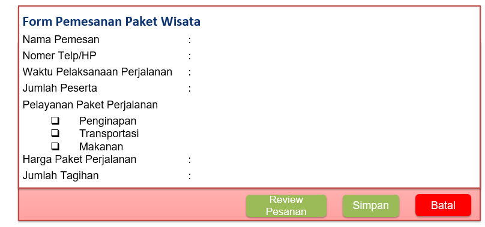
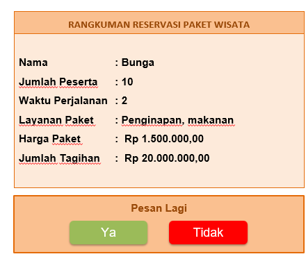

# 📚 Pertemuan 1: Pendahuluan

---

## 👋 Pengantar

Selamat datang di **Pemrograman Web Lanjut**! Minggu pertama ini kita review dulu web dasar, sekaligus dapet gambaran project yang bakal kita bangun step-by-step di pertemuan-pertemuan berikutnya: sistem **Pemesanan Paket Wisata**.

Project ini yang bakal jadi benang merah dari minggu ke minggu — mulai dari bikin form, validasi, sampai nanti nyambung ke database, register/login (lihat [Pertemuan 7](./week-7.md)), dst.

---

## 🧾 Tugas: Buatlah Halaman Pesan Paket Wisata

Bikin halaman form pemesanan paket wisata seperti wireframe berikut:



Field yang harus ada:

- Nama Pemesan
- Nomer Telp/HP
- Waktu Pelaksanaan Perjalanan
- Jumlah Peserta
- Pelayanan Paket Perjalanan (checkbox: Penginapan, Transportasi, Makanan)
- Harga Paket Perjalanan
- Jumlah Tagihan

Ada 3 tombol aksi: **Review Pesanan**, **Simpan**, **Batal**.

Jika pesanan sudah disimpan, akan muncul tampilan resume pemesanan dan tombol perintah untuk pesan lagi atau tidak:



---

## ✅ Aturan Validasi Pemesanan Paket Wisata

1. Jika form isian belum di-input, maka muncul pesan "data form pemesanan terisi"
2. Jika pilih pelayanan paket perjalanan, itu jadi parameter pengisian field **Harga Paket Perjalanan**:

| Layanan | Harga |
|---------|-------|
| 🏨 Penginapan | Rp 1.000.000 |
| 🚌 Transportasi | Rp 1.200.000 |
| 🍽️ Makanan | Rp 500.000 |

**Contoh perhitungan:**

Waktu perjalanan 2 hari, jumlah peserta = 2, kemudian pilihannya penginapan dan transportasi, maka:

```
harga paket perjalanan = 1.000.000 + 1.200.000 = 2.200.000
jumlah tagihan = 2 hari x 2 peserta x 2.200.000 = 4.800.000
```

> 💡 Rumus umumnya: `jumlah_tagihan = jumlah_hari x jumlah_peserta x harga_paket_perjalanan`, dimana `harga_paket_perjalanan` adalah penjumlahan dari layanan yang dicentang.

---

> "Masa depan itu tergantung pada apa yang kita lakukan hari ini" — Mahatma Gandhi

**✨ End of Week 1 ✨**
