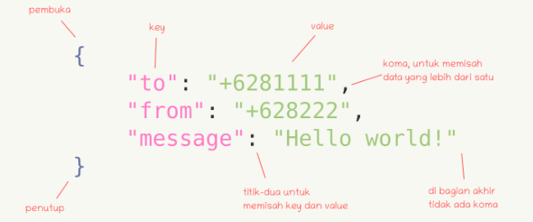

# 🧩 Pertemuan 11: Fungsi JSON

---

## 👋 Pengertian JSON

**JSON** (JavaScript Object Notation) adalah format pertukaran data yang ringan, mudah dibaca dan ditulis oleh manusia, serta mudah diterjemahkan dan dibuat oleh komputer.

JSON bisa diartikan sebagai teks dengan format tertentu yang digunakan untuk memfasilitasi pertukaran data antar bahasa pemrograman. JSON berasal dari bahasa pemrograman JavaScript untuk merepresentasikan struktur data sederhana dan array asosiatif yang disebut *object*.

PHP udah nyediain perintah buat **encode** ke bentuk JSON, ataupun sebaliknya **decode** dari bentuk JSON ke array.

JSON merupakan format teks yang ga bergantung pada bahasa pemrograman apapun, karena pakai gaya bahasa yang umum dipakai programmer keluarga C (C, C++, C#, Java, JavaScript, Perl, Python, dll). JSON pertama kali dipopulerkan oleh **Douglas Crockford**, software engineer yang juga terlibat dalam pengembangan JavaScript.

### Kelebihan JSON

- Ukuran lebih kecil dibanding XML → transfer data lebih cepat & hemat bandwidth
- Format data bawaan JavaScript — kalau client pakai JS, ga perlu library tambahan
- Lebih sederhana dibanding XML
- Library JSON ada di hampir semua bahasa pemrograman

### Penerapan JSON

- Format tukar-data client ↔ server / antar aplikasi (contoh: RESTful API)
- Tempat menyimpan data (contoh: database MongoDB)
- Menyimpan konfigurasi project (contoh: `composer.json` di PHP, `package.json` di Node.js)
- Menyimpan konfigurasi & data pada Hugo
- Menyimpan data manifest

---

## 🧱 Struktur Dasar JSON



```json
{
  "to": "+6281111",
  "from": "+628222",
  "message": "Hello world!"
}
```

| Elemen | Keterangan |
|--------|------------|
| `[` | **Array** — tanda kurung siku mewakili JSONArray |
| `{` | **Objek** — kurung kurawal mewakili JSONObject |
| **Key** | objek JSON berisi kunci yang hanya berupa string. Pasangan kunci/nilai membentuk JSONObject |
| **Value** | tiap kunci punya nilai yang bisa berupa string, integer, atau double |

Beberapa method umum di objek JSON (mis. `getJSONObject` versi Java/Android, konsepnya sama di bahasa lain):

| Method | Fungsi |
|--------|--------|
| `get(String name)` | mengembalikan nilai dalam bentuk Objek |
| `getBoolean(String name)` | mengembalikan nilai boolean berdasarkan kunci |
| `getDouble(String name)` | mengembalikan nilai double berdasarkan kunci |
| `getInt(String name)` | mengembalikan nilai integer berdasarkan kunci |
| `getLong(String name)` | mengembalikan nilai long berdasarkan kunci |
| `length()` | mengembalikan jumlah pasangan nama/nilai dalam objek |
| `names()` | mengembalikan array berisi nama-nama string dalam objek |

Kode lengkap CRUD JSON pakai PHP ada di [`src/week-11/`](./src/week-11/).

---

## 1️⃣ create.php — Membuat File JSON

```php
$data [] = array('no' => 1, 'nama' => 'Rudi', 'alamat' => 'Depok');
$data [] = array('no' => 2, 'nama' => 'Indah', 'alamat' => 'Pamulang');

$jsonfile = json_encode($data, JSON_PRETTY_PRINT);
file_put_contents('anggota.json', $jsonfile);
```

Kalau ga ada error dan muncul file baru bernama `anggota.json` di folder yang sama, berarti berhasil.

- `json_encode()` — encode data array jadi JSON
- `JSON_PRETTY_PRINT` — bikin tampilan JSON hasil encode rapi & mudah dibaca
- `file_put_contents()` — bikin file baru (kalau belum ada) dan simpan data

📄 [`src/week-11/create.php`](./src/week-11/create.php)

---

## 2️⃣ read.php — Menampilkan Data dari JSON

```php
$file = "anggota.json";
$anggota = file_get_contents($file);
$data = json_decode($anggota, true);

foreach ($data as $d) {
    echo $d['no']. "<br>";
    echo $d['nama']. "<br>";
    echo $d['alamat']. "<br>";
}
```

- `file_get_contents()` — baca JSON jadi string
- `json_decode($str, true)` — decode string JSON jadi array (`true` = associative array, bukan object)

📄 [`src/week-11/read.php`](./src/week-11/read.php)

---

## 3️⃣ insert.php — Menambahkan Data ke JSON

Baca dulu isi `anggota.json` yang ada, tambahin data baru ke array-nya, baru encode & simpan ulang.

```php
$data [] = array('no' => 3, 'nama' => 'Elika', 'alamat' => 'Jakarta');
```

📄 [`src/week-11/insert.php`](./src/week-11/insert.php)

---

## 4️⃣ update.php — Memperbarui Data JSON

Contoh: update data nomor 2 (Indah), alamat dari Pamulang jadi Bogor.

```php
foreach ($data as $key => $d) {
    if ($d['no'] === 2) {
        $data[$key]['alamat'] = 'Bogor';
    }
}
```

`$key` di sini adalah index array data yang mau diperbarui.

📄 [`src/week-11/update.php`](./src/week-11/update.php)

---

## 5️⃣ delete.php — Menghapus Data dari JSON

Contoh: hapus data nomor 2 (Indah).

```php
foreach ($data as $key => $d) {
    if ($d['no'] === 2) {
        array_splice($data, $key, 1);
    }
}
```

`array_splice()` menghapus elemen array pada index `$key` sebanyak 1 elemen.

📄 [`src/week-11/delete.php`](./src/week-11/delete.php)

---

## 📌 Tugas

> Buat fungsi JSON pada projek akhir yang dibuat.

---

**✨ End of Week 11 ✨**
