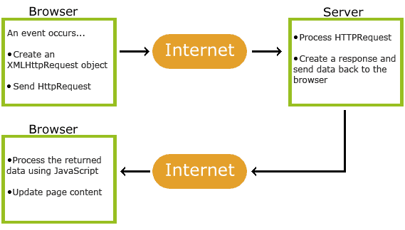

# ⚡ Pertemuan 14: Fungsi AJAX

---

## 👋 AJAX dan Reload Halaman

Di mesin pencari, tiap kali kita masukin kunci pencarian ke Google, Google bakal reload seluruh halamannya buat nampilin hasil pencarian. Tapi coba perhatiin, ketika kita klik **like** di postingan Facebook, Facebook **ga** reload seluruh halamannya cuma buat nambah satu like. Facebook pakai **AJAX** buat nampilin perubahan data status like tanpa harus reload seluruh halaman.

## AJAX itu apa?

**AJAX** = **A**synchronous **J**avascript **A**nd **X**ML.

Meskipun ada istilah XML, tapi format data yang lebih sering dipakai AJAX sekarang adalah teks atau **JSON** (lihat [Pertemuan 11](./week-11.md)). XML dan JSON sama-sama format pertukaran data.

AJAX meniadakan reload seluruh halaman sehingga proses load lebih cepat. Kunci utama AJAX ada di obyek **`XMLHttpRequest`** — obyek ini berperan penting dalam pertukaran data antara klien dengan server. Request AJAX dikirim klien pakai obyek ini, dan dengan obyek ini pula server merespons.

> 💡 Buat pakai AJAX sebaiknya kita udah kuasai dulu HTML, JavaScript, jQuery, dan database.

Teknologi yang termasuk dalam aplikasi AJAX:

| Teknologi | Peran |
|-----------|-------|
| **HTML** | membuat web forms dan mengidentifikasikan field yang dipakai |
| **JavaScript** | kode inti untuk menjalankan aplikasi AJAX dan memfasilitasi komunikasi |
| **DHTML** (Dynamic HTML) | bikin form/web dinamis pakai `<div>`, `<span>`, dan elemen HTML dinamis lainnya |
| **DOM** (Document Object Model) | dipakai (lewat kode JavaScript) buat kerja dengan struktur HTML dan XML |

### Fungsi JavaScript

Fungsi JavaScript akan sering dipakai bareng AJAX. Sintaksnya:

```js
function nm_fungsi(param1, param2, ...){
    var nm_var = nil_var;
    // ...
    return nm_var;
}
```

- deklarasi variable pakai kata kunci `var`
- kembalikan hasil fungsi pakai `return`
- panggil fungsi: tulis nama fungsi diikuti kurung buka-tutup `nm_fungsi();`

---

## 🔄 Langkah-Langkah AJAX



1. Browser klien membuat obyek `XMLHttpRequest` dan mengirim ke server
2. Server memproses dan merespon serta mengirim data balik ke browser
3. Browser mengolah data kiriman menggunakan JavaScript
4. Browser mengupdate konten

---

## 💻 Contoh Program AJAX — GET

```html
<div id="box"></div>
<script type="text/javascript">
    var xhr = new XMLHttpRequest();
    xhr.onreadystatechange = function(){
        if (xhr.readyState === 4 && xhr.status === 200){
            console.log("berhasil");
            data = JSON.parse(xhr.responseText);
            document.getElementById('box').innerHTML = data.usia;
        }
    }
    xhr.open('GET', 'data.json', true);
    xhr.send();
</script>
```

📄 [`src/week-14/ajax-get-example.html`](./src/week-14/ajax-get-example.html) + [`src/week-14/data.json`](./src/week-14/data.json)

> 🐛 **Transkrip apa adanya:** `data.json` isinya `{"Nama": "Bambang", "Usia": 30}` — key-nya kapital `Usia`. Tapi kode JS-nya baca `data.usia` (huruf kecil semua). Di JavaScript, akses property itu **case-sensitive**, jadi `data.usia` bakal `undefined`, bukan `30`. Coba benerin sendiri: samain casing-nya jadi `data.Usia` (atau ubah `data.json` jadi lowercase semua).

### Penjelasan Program

- `<div id="box"></div>` — elemen tempat data bakal ditampilin
- `var xhr = new XMLHttpRequest();` — bikin obyek `XMLHttpRequest`, disimpan ke variabel `xhr`
- `xhr.onreadystatechange` — property yang mendefinisikan fungsi yang dipanggil tiap kali property `readyState` berubah. `readyState` berisi status dari request: **(1)** koneksi terbentuk, **(2)** request diterima, **(3)** request diproses, **(4)** request selesai diproses dan respon siap
- cek `xhr.readyState === 4 && xhr.status === 200` — artinya request udah selesai **dan** berhasil (status HTTP 200)
- `xhr.responseText` — isi data mentah yang dikirim server. Karena berupa JSON, perlu di-`JSON.parse()` dulu biar bisa diambil isinya
- `document.getElementById('box').innerHTML = data.usia` — nilainya dicetak ke elemen `div#box`

Hal mendasar yang perlu dipahami: program AJAX biasanya bakal ngirim data tertentu ke server, kemudian data itu diolah server dan hasilnya dikirim balik ke browser klien. Ada semacam "dialog" antara klien-server berupa pertukaran data. Data yang dari server diolah oleh browser pakai JavaScript, bukan PHP.

---

## 💻 Contoh Program AJAX — Mengirim Data ke Server (POST)

Contoh form yang ngirim data artikel (title + body) ke API pakai AJAX:

```js
function sendData() {
    var xhr = new XMLHttpRequest();
    var url = "https://jsonplaceholder.typicode.com/posts";

    var data = JSON.stringify({
        title: document.getElementById("title").value,
        body: document.getElementById("body").value,
        userId: 1
    });

    xhr.open("POST", url, true);
    xhr.setRequestHeader("Content-Type", "application/json;charset=UTF-8");
    xhr.onload = function () {
        console.log(this.responseText);
    };

    xhr.send(data);
    return false;
}
```

Bedanya sama contoh GET:

- `xhr.open("POST", url, true)` — method-nya `POST`, bukan `GET`
- `xhr.setRequestHeader(...)` — kasih tau server kalau body request-nya berformat JSON
- `JSON.stringify({...})` — kebalikan dari `JSON.parse()`, ubah object JS jadi string JSON buat dikirim
- form pakai `onsubmit="return sendData()"` — `return false` di akhir fungsi supaya form ga ngirim data dengan cara submit biasa (reload halaman), karena udah ditangani AJAX

📄 [`src/week-14/ajax.html`](./src/week-14/ajax.html)

---

## 📌 Tugas

> Buatlah form pada projek UTS dengan menggunakan fungsi AJAX.

---

**✨ End of Week 14 ✨**
