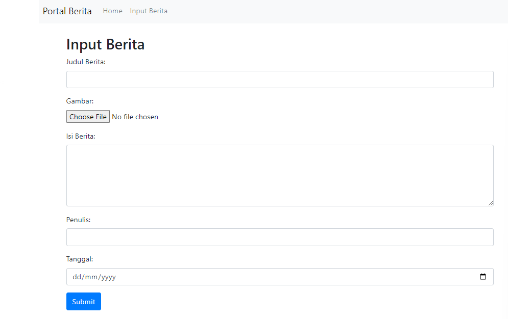

# 🔄 Pertemuan 6: Fungsi CRUD dengan PHP

*(Create, Read, Update dan Delete)*

---

## 👋 Apa itu CRUD?

CRUD terbagi dari 4 proses:

| Operasi | Penjelasan |
|---------|------------|
| **Create** | membuat data — contohnya membuat sistem pendaftaran / membuat data baru di PHP yang dimasukkan ke database |
| **Read** | membaca data — menampilkan data yang ada di database, dibaca menggunakan pemrograman PHP |
| **Update** | memperbarui data — memperbarui/mengedit data yang ada di database via PHP |
| **Delete** | menghapus data — cara paling mudah, menghapus data yang ada di database lewat PHP |

### Struktur File

| File | Fungsi |
|------|--------|
| `index.php` | Main list dan link ke file lainnya |
| `add.php` (`tambah.php`) | Tambah entry baru |
| `delete.php` (`hapus.php`) | Hapus entry |
| `edit.php` | Edit data yang ada |
| `view.php` | (kalau `index.php` butuh detail view) |

Kode lengkap ada di [`src/week-6/`](./src/week-6/). Struktur tabel `mahasiswa` yang dipakai (database `akademik`):

| Kolom | Tipe |
|-------|------|
| `id` | `varchar(10)`, primary key, auto_increment |
| `nama` | `varchar(50)` |
| `nim` | `int(11)` |
| `alamat` | `text` |

📄 [`src/week-6/create_table_mahasiswa.sql`](./src/week-6/create_table_mahasiswa.sql)

---

## 🔗 Koneksi Database

```php
<?php
$koneksi = mysqli_connect("localhost","root","","akademik");

// Check connection
if (mysqli_connect_errno()){
    echo "Koneksi database gagal : " . mysqli_connect_error();
}
?>
```

📄 [`src/week-6/koneksi.php`](./src/week-6/koneksi.php)

---

## 📖 Fungsi View — `index.php`

Buatlah sebuah file dengan nama `index.php`, nampilin semua data mahasiswa dalam tabel plus link EDIT/HAPUS per baris.

```php
<table border="1">
    <tr><th>NO</th><th>Nama</th><th>NIM</th><th>Alamat</th><th>OPSI</th></tr>
    <?php
    include 'koneksi.php';
    $no = 1;
    $data = mysqli_query($koneksi,"select * from mahasiswa");
    while($d = mysqli_fetch_array($data)){
    ?>
    <tr>
        <td><?php echo $no++; ?></td>
        <td><?php echo $d['nama']; ?></td>
        <td><?php echo $d['nim']; ?></td>
        <td><?php echo $d['alamat']; ?></td>
        <td>
            <a href="edit.php?id=<?php echo $d['id']; ?>">EDIT</a>
            <a href="hapus.php?id=<?php echo $d['id']; ?>">HAPUS</a>
        </td>
    </tr>
    <?php } ?>
</table>
```

📄 [`src/week-6/index.php`](./src/week-6/index.php)

---

## ➕ Fungsi Insert — `tambah.php` + `tambah_aksi.php`

Form-nya (output-nya kayak gini):

```
BELAJAR PEMOGRAMAN WEB 3
KEMBALI

TAMBAH DATA MAHASISWA
Nama    [___________]
NIM     [___________]
Alamat  [___________]
[SIMPAN]
```

```php
<!-- tambah.php -->
<form method="post" action="tambah_aksi.php">
    <table>
        <tr><td>Nama</td><td><input type="text" name="nama"></td></tr>
        <tr><td>NIM</td><td><input type="number" name="nim"></td></tr>
        <tr><td>Alamat</td><td><input type="text" name="alamat"></td></tr>
        <tr><td></td><td><input type="submit" value="SIMPAN"></td></tr>
    </table>
</form>
```

```php
<!-- tambah_aksi.php -->
<?php
// koneksi database
include 'koneksi.php';

// menangkap data yang di kirim dari form
$nama = $_POST['nama'];
$nim = $_POST['nim'];
$alamat = $_POST['alamat'];

// menginput data ke database
mysqli_query($koneksi,"insert into mahasiswa values('','$nama','$nim','$alamat')");

// mengalihkan halaman kembali ke index.php
header("location:index.php");
?>
```

📄 [`src/week-6/tambah.php`](./src/week-6/tambah.php) + [`src/week-6/tambah_aksi.php`](./src/week-6/tambah_aksi.php)

---

## ✏️ Fungsi Update — `edit.php` + `update.php`

`edit.php` ambil data mahasiswa berdasarkan `id` dari URL, tampilin form yang udah keisi nilai lama-nya, `id`-nya disimpan sebagai `hidden` input:

```php
<?php
include 'koneksi.php';
$id = $_GET['id'];
$data = mysqli_query($koneksi,"select * from mahasiswa where id='$id'");
while($d = mysqli_fetch_array($data)){
?>
<form method="post" action="update.php">
    <table>
        <tr><td>Nama</td><td>
            <input type="hidden" name="id" value="<?php echo $d['id']; ?>">
            <input type="text" name="nama" value="<?php echo $d['nama']; ?>">
        </td></tr>
        <tr><td>NIM</td><td><input type="number" name="nim" value="<?php echo $d['nim']; ?>"></td></tr>
        <tr><td>Alamat</td><td><input type="text" name="alamat" value="<?php echo $d['alamat']; ?>"></td></tr>
        <tr><td></td><td><input type="submit" value="SIMPAN"></td></tr>
    </table>
</form>
<?php } ?>
```

```php
<!-- update.php -->
<?php
include 'koneksi.php';
$id = $_POST['id'];
$nama = $_POST['nama'];
$nim = $_POST['nim'];
$alamat = $_POST['alamat'];

mysqli_query($koneksi,"update mahasiswa set nama='$nama', nim='$nim', alamat='$alamat' where id='$id'");

header("location:index.php");
?>
```

📄 [`src/week-6/edit.php`](./src/week-6/edit.php) + [`src/week-6/update.php`](./src/week-6/update.php)

> ℹ️ Deck aslinya cuma nunjukin bagian bawah `edit.php` (mulai dari `include 'koneksi.php'`) — bagian atas (`<!DOCTYPE>`, `<head>`, header halaman) direkonstruksi biar konsisten sama `tambah.php`.

---

## 🗑️ Fungsi Delete — `hapus.php`

```php
<?php
// koneksi database
include 'koneksi.php';

// menangkap data id yang di kirim dari url
$id = $_GET['id'];

// menghapus data dari database
mysqli_query($koneksi,"delete from mahasiswa where id='$id'");

// mengalihkan halaman kembali ke index.php
header("location:index.php");
?>
```

📄 [`src/week-6/hapus.php`](./src/week-6/hapus.php)

> 🐛 **Transkrip apa adanya:** slide-nya nulis "*Buatlah file `hapus.php` yang merupakan file yang akan mengupdate data mahasiswa*" — padahal fungsinya jelas **menghapus** (`DELETE`), bukan update. Kelihatan salah ketik di materi aslinya.

---

## 📌 Latihan

> Buatlah fungsi CRUD pada web portal seperti dibawah ini:



Mockup-nya berupa form **Input Berita**: Judul Berita, Gambar (upload file), Isi Berita, Penulis, Tanggal, dan tombol Submit.

---

**✨ End of Week 6 ✨**
